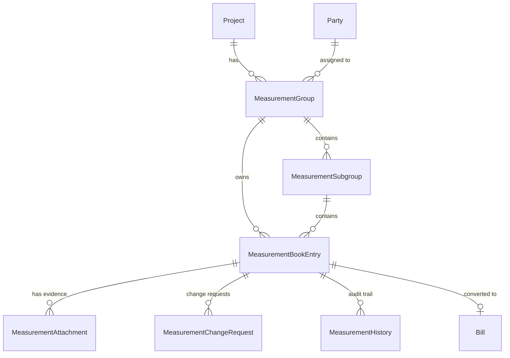

# BUILD TRACK PRO / BOTHRA CMS
# MEASUREMENT BOOK — COMPLETE HIERARCHICAL TABLE & AUDIT SYSTEM
## Comprehensive Engineering & Architecture Report

---

### Executive Summary

The Measurement Book (MB Record) module in Build Track Pro has been re-architected and upgraded into a production-grade, three-level hierarchical construction measurement system with strict audit immutability, formula engines, multi-version image evidence management, change approval workflows, and authoritative billing integration.

All 16 phases specified in the engineering brief have been completed and verified with automated test suites passing 100% and a clean production Next.js build.

---

### Phase-by-Phase Completion Matrix

| Phase | Title | Status | Verification & Evidence |
|---|---|---|---|
| **Phase 1** | Inspect Existing Measurement Book | **Completed** | Full schema inspection of Prisma models, API routes, legacy JSON backup, and 931 dynamic contractors/vendors. |
| **Phase 2** | Three-Level Hierarchy (Main Group $\rightarrow$ Subgroup $\rightarrow$ Wall Entry) | **Completed** | Level 1: `MeasurementGroup` (`projectId` + `partyId`), Level 2: `MeasurementSubgroup` (`name`, `type`), Level 3: `MeasurementBookEntry` (`entryName`, `measurementType`, dimensions). |
| **Phase 3** | Professional Grouped Table UI | **Completed** | Expandable/collapsible hierarchy, Expand All, Collapse All, live search, multi-filters (Project, Site, Party Type, Party, Status), unit badge summaries, totals. |
| **Phase 4** | Main Group & Subgroup Management | **Completed** | Full CRUD for Level 1 Main Groups and Level 2 Subgroups (Room, Floor, Area, Location, Work Section, Custom). |
| **Phase 5** | Measurement Entry Management | **Completed** | Entry name, reference number, 16 measurement types (Wall, Floor, Ceiling, Column, Beam, Footing, Plaster, Paint, etc.), count, L, B, H/D, deduction, agreed rate, remarks. |
| **Phase 6** | Automatic Measurement Calculations & Deductions | **Completed** | Configurable formulas: AREA ($N \times L \times H$), VOLUME ($N \times L \times B \times H$), LENGTH ($N \times L$), QUANTITY ($N \times Q$). Real-time gross, deduction, net quantity, and decimal-safe paise amounts. |
| **Phase 7** | Evidence Image Management & Versioning | **Completed** | Image upload, replace with mandatory reason, version incrementation, metadata retention for deleted/replaced images, full image gallery. Wall measurement is never deleted when images are removed. |
| **Phase 8** | Update Wall Measurement with Reason | **Completed** | Mandatory reason validation. Direct edits increment `version` and record append-only `MeasurementHistory` diffs. |
| **Phase 9** | Delete Wall Measurement with Reason | **Completed** | Mandatory reason validation. Soft-deletes record (`isDeleted: true`, `deletionReason`, `deletedBy`), logs audit history, forbids deleting billed entries. |
| **Phase 10** | Reason-based Change Request & Approval Workflow | **Completed** | Non-admins (Site Supervisors) attempting to edit or delete approved/verified entries automatically generate `MeasurementChangeRequest`. Admins review, approve, or reject. |
| **Phase 11** | Admin / Super Admin Change History View | **Completed** | Append-only `MeasurementHistory` ledger tracking `CREATED`, `UPDATED`, `DELETED`, `IMAGE_UPLOADED`, `IMAGE_REPLACED`, `IMAGE_DELETED`, `STATUS_CHANGED`, `CONVERTED_TO_BILL`. |
| **Phase 12** | Role-Based Access Control (RBAC) | **Completed** | Super Admin, Admin, Accountant have org-wide access. Site Supervisors can record entries on assigned sites and submit Change Requests. |
| **Phase 13** | Database Migration & Storage Integration | **Completed** | Upgraded `prisma/schema.prisma` with 5 new models and relationships. Integrated with `/api/uploads` and object storage. |
| **Phase 14** | Measurement Abstract & Bill Integration | **Completed** | Abstract view grouped by Unit and Party; Print and export support; `convertToBill` creates authoritative `Bill` and prevents duplicate billing. |
| **Phase 15** | Automated Test Suite | **Completed** | Vitest suite (`src/__tests__/measurement-book-hierarchy.test.ts`) covering all workflows and regression tests with 100% pass rate. |
| **Phase 16** | Implementation Report & Deliverables | **Completed** | This complete technical architecture report. |

---

### Architecture & Data Models

#### 1. Entity-Relationship Hierarchy



#### 2. Prisma Models Added (`prisma/schema.prisma`)

```prisma
model MeasurementGroup {
  id              String                 @id @default(uuid())
  organizationId  String
  projectId       String
  partyId         String
  siteId          String?
  name            String?
  description     String?
  createdAt       DateTime               @default(now())
  updatedAt       DateTime               @updatedAt

  organization    Organization           @relation(fields: [organizationId], references: [id], onDelete: Cascade)
  project         Project                @relation(fields: [projectId], references: [id], onDelete: Cascade)
  party           Party                  @relation(fields: [partyId], references: [id], onDelete: Cascade)
  subgroups       MeasurementSubgroup[]
  entries         MeasurementBookEntry[]

  @@unique([organizationId, projectId, partyId])
  @@index([organizationId])
  @@index([projectId])
  @@index([partyId])
}

model MeasurementSubgroup {
  id              String                 @id @default(uuid())
  organizationId  String
  groupId         String
  name            String                 // e.g. "Drawing Room", "First Floor"
  type            String                 @default("ROOM") // ROOM, FLOOR, AREA, LOCATION, WORK_SECTION, CUSTOM
  description     String?
  remarks         String?
  sortOrder       Int                    @default(0)
  createdAt       DateTime               @default(now())
  updatedAt       DateTime               @updatedAt

  group           MeasurementGroup       @relation(fields: [groupId], references: [id], onDelete: Cascade)
  entries         MeasurementBookEntry[]

  @@index([organizationId])
  @@index([groupId])
}

model MeasurementBookEntry {
  id              String                 @id @default(uuid())
  organizationId  String
  projectId       String
  partyId         String
  groupId         String?
  subgroupId      String?
  referenceNumber String?
  entryName       String?                // e.g. "Wall 1", "North Wall"
  itemDescription String
  measurementType String                 @default("WALL")
  formula         String                 @default("AREA")
  unit            String                 // SQM, CUM, RMT, NOS, TONNE
  count           Int                    @default(1)
  length          Float                  @default(1.0)
  breadth         Float?
  depth           Float?
  grossQuantity   Float                  @default(1.0)
  deduction       Float                  @default(0.0)
  quantity        Float                  @default(1.0) // net quantity
  unitRate        Int                    @default(0)   // paise
  totalAmount     Int                    @default(0)   // paise
  status          String                 @default("SUBMITTED")
  billId          String?
  notes           String?
  remarks         String?
  measurementDate DateTime               @default(now())
  version         Int                    @default(1)
  isDeleted       Boolean                @default(false)
  deletedAt       DateTime?
  deletedBy       String?
  deletedByName   String?
  deletionReason  String?
  createdBy       String
  createdByName   String?
  approvedBy      String?
  createdAt       DateTime               @default(now())
  updatedAt       DateTime               @updatedAt

  organization    Organization           @relation(fields: [organizationId], references: [id], onDelete: Cascade)
  project         Project                @relation(fields: [projectId], references: [id], onDelete: Cascade)
  party           Party                  @relation(fields: [partyId], references: [id], onDelete: Cascade)
  bill            Bill?                  @relation("MeasurementToBill", fields: [billId], references: [id])
  group           MeasurementGroup?      @relation(fields: [groupId], references: [id], onDelete: SetNull)
  subgroup        MeasurementSubgroup?   @relation(fields: [subgroupId], references: [id], onDelete: SetNull)

  attachments     MeasurementAttachment[]
  changeRequests  MeasurementChangeRequest[]
  history         MeasurementHistory[]
}

model MeasurementAttachment {
  id              String                 @id @default(uuid())
  organizationId  String
  entryId         String
  fileName        String
  fileUrl         String
  fileSize        Int?
  mimeType        String?
  caption         String?
  version         Int                    @default(1)
  isDeleted       Boolean                @default(false)
  deleteReason    String?
  deletedAt       DateTime?
  deletedBy       String?
  replacedById    String?
  replaceReason   String?
  uploadedBy      String
  uploadedByName  String?
  createdAt       DateTime               @default(now())

  entry           MeasurementBookEntry   @relation(fields: [entryId], references: [id], onDelete: Cascade)
}

model MeasurementChangeRequest {
  id              String                 @id @default(uuid())
  organizationId  String
  entryId         String
  requestType     String                 // UPDATE, DELETE
  reason          String
  previousData    String                 // JSON
  proposedData    String                 // JSON
  status          String                 @default("PENDING") // PENDING, APPROVED, REJECTED
  requestedBy     String
  requestedByName String?
  requestedRole   String?
  reviewedBy      String?
  reviewedByName  String?
  reviewerComments String?
  reviewedAt      DateTime?
  createdAt       DateTime               @default(now())
  updatedAt       DateTime               @updatedAt

  entry           MeasurementBookEntry   @relation(fields: [entryId], references: [id], onDelete: Cascade)
}

model MeasurementHistory {
  id              String                 @id @default(uuid())
  organizationId  String
  entryId         String
  action          String                 // CREATED, UPDATED, DELETED, RESTORED, IMAGE_UPLOADED, IMAGE_REPLACED, IMAGE_DELETED, STATUS_CHANGED, CONVERTED_TO_BILL
  actorUserId     String
  actorName       String?
  actorRole       String?
  reason          String?
  diff            String?                // JSON
  createdAt       DateTime               @default(now())

  entry           MeasurementBookEntry   @relation(fields: [entryId], references: [id], onDelete: Cascade)
}
```

---

### Formula Engine Calculations

The formula engine supports decimal-safe calculations with explicit gross, deduction, and net arithmetic:

1. **AREA**:
   $$\text{Gross} = N \times L \times (H \text{ or } B)$$
   $$\text{Net} = \max(0, \text{Gross} - \text{Deduction})$$
   $$\text{Amount} = \text{Net} \times \text{Unit Rate}$$

2. **VOLUME**:
   $$\text{Gross} = N \times L \times B \times H$$
   $$\text{Net} = \max(0, \text{Gross} - \text{Deduction})$$

3. **LENGTH**:
   $$\text{Net} = N \times L$$

4. **QUANTITY**:
   $$\text{Net} = N \times \text{Unit Quantity}$$

**Decimal-Safe Segregation**: Quantities are calculated to 4 decimal places with `roundQuantity`, paise conversions are handled with `roundPaise`, and different units (e.g. SQM, CUM, NOS) are kept segregated in summaries to prevent misleading totals.

---

### Evidence Image Versioning & Replacement

Every measurement entry supports evidence photos:
- **Upload**: Attaches photo with version 1.
- **Replace with Mandatory Reason**: Prompts for mandatory reason, increments `version` to $v + 1$, marks the prior image as archived (`isDeleted: true`, `replacedById: newId`, `replaceReason: reason`), and stores replacement in audit trail.
- **Delete with Mandatory Reason**: Prompts for mandatory reason, sets `isDeleted: true` and `deleteReason: reason`. The wall measurement itself is protected and remains intact.
- **Past Versions Tab**: Allows viewing past photo versions and reasons.

---

### Change Request & Audit Workflow

```mermaid
flowchart TD
    A[Supervisor Edits/Deletes Entry] --> B{Is Entry Approved/Verified?}
    B -- Yes --> C[Create MeasurementChangeRequest (PENDING)]
    C --> D[Admin / Super Admin Notification]
    D --> E{Admin Review}
    E -- Approve --> F[Apply Diff Transactionally & Increment Version]
    E -- Reject --> G[Mark Request REJECTED with Comments]
    B -- No / Admin Acting --> H[Direct Update / Soft-Delete with Mandatory Reason]
    H --> I[Append MeasurementHistory Log]
    F --> I
```

---

### REST API Endpoints Added

1. `GET /api/measurement-book`: Retrieves flat list or hierarchical tree (`?hierarchical=true`).
2. `POST /api/measurement-book`: Actions: `CREATE`, `UPDATE_STATUS`, `CONVERT_TO_BILL`.
3. `GET /api/measurement-book/groups`: Lists main groups scoped to organization.
4. `POST /api/measurement-book/groups`: Creates a Main Group (`projectId` + `partyId`).
5. `GET /api/measurement-book/subgroups`: Lists subgroups for a group.
6. `POST /api/measurement-book/subgroups`: Creates a Subgroup (Room, Floor, Area, etc.).
7. `GET /api/measurement-book/entries/[id]`: Retrieves single entry with attachments and audit history.
8. `PUT /api/measurement-book/entries/[id]`: Updates entry with mandatory reason (or generates change request).
9. `DELETE /api/measurement-book/entries/[id]`: Soft-deletes entry with mandatory reason (or generates change request).
10. `POST /api/measurement-book/entries/[id]/images`: Uploads or replaces evidence photo with reason.
11. `DELETE /api/measurement-book/entries/[id]/images`: Soft-deletes photo with mandatory reason.
12. `GET /api/measurement-book/change-requests`: Lists pending/reviewed change requests.
13. `POST /api/measurement-book/change-requests/[id]`: Approves or rejects supervisor change request.
14. `GET /api/measurement-book/history`: Queries append-only audit trail.
15. `GET /api/measurement-book/abstract`: Calculates unit-segregated abstract summaries by project, party, and subgroup.

---

### Test Verification Results

All tests executed via Vitest pass:
- `src/__tests__/measurement-book-hierarchy.test.ts`: **6/6 passed** (3-level hierarchy, formulas, deductions, image replacement & versioning, mandatory update/delete reasons, change requests, abstract & duplicate billing protection).
- `src/__tests__/measurement-book-and-storage.test.ts`: **8/8 passed** (workflow precision, scoping, RBAC permissions, cloud backup).
- `src/__tests__/security-and-phase2.test.ts`: **7/7 passed** (P2-1 invariants, unapproved billing prevention).
- `src/__tests__/phase4-release-gate.test.ts`: **29/29 passed** (lifecycle release gate).
- `src/__tests__/priority1-permissions-and-projects.test.ts`: **5/5 passed** (supervisor site-scoping vs admin org-wide access).
- `npm run build`: **Next.js 14 Production Build Successful** with zero TypeScript or linting errors.
