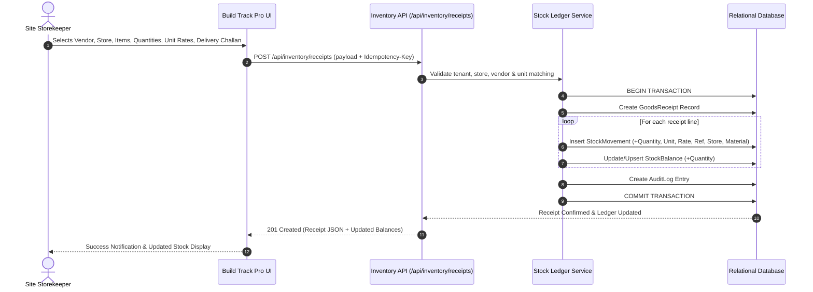
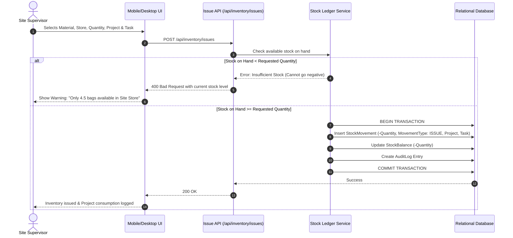
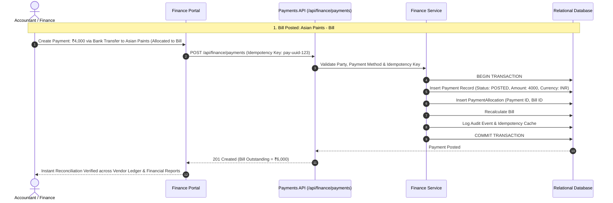
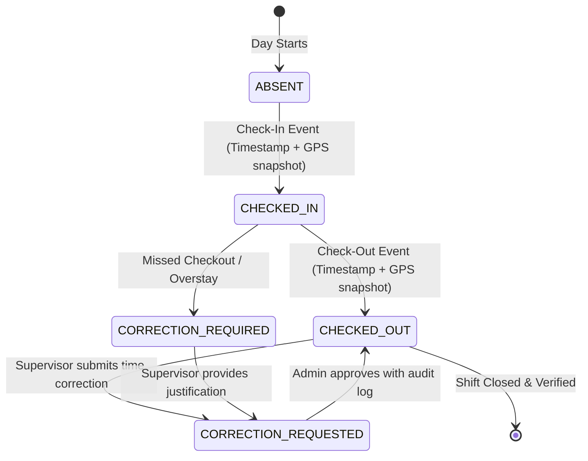
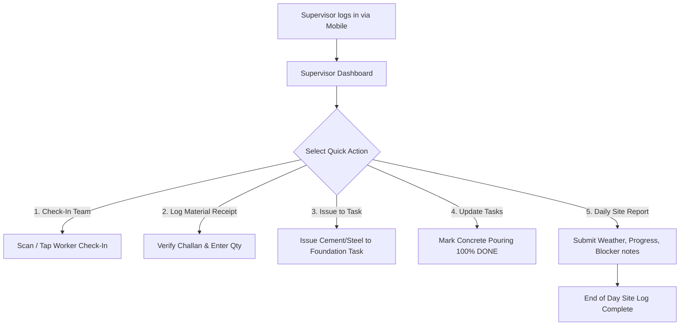

# Application Flows & User Journeys

## 1. Material Goods Receipt Flow (Storekeeper)

## 2. Material Issue & Task Consumption Flow

## 3. Vendor Bill, Payment & Reconciliation Flow

## 4. Workforce Attendance & Correction Flow

## 5. Supervisor Quick-Action Daily Flow

