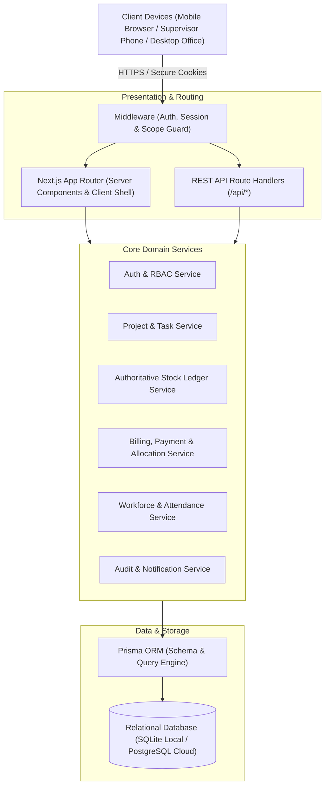
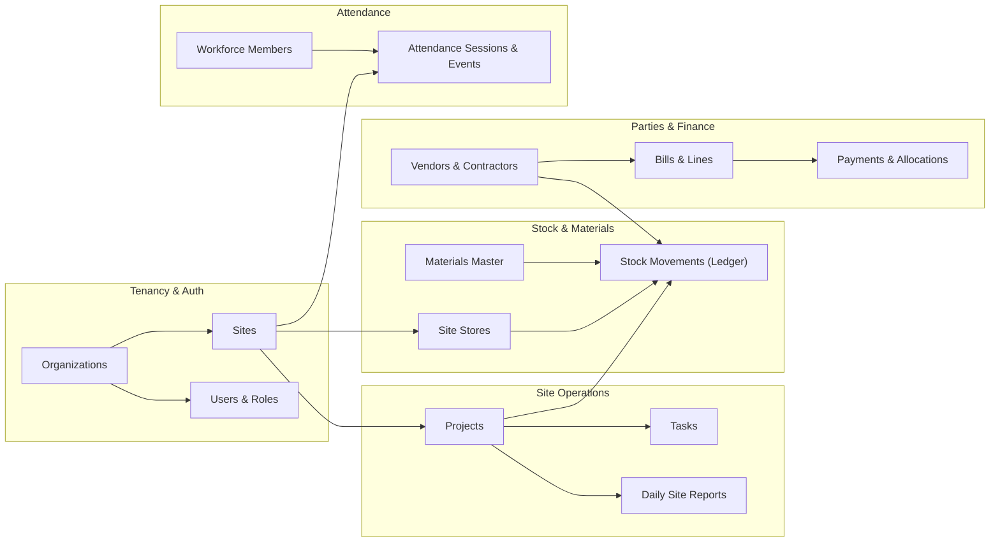

# Architecture & Module Boundaries

## 1. System Context & Layered Model

## 2. Module Boundaries & Interaction Matrix

## 3. Data Flow Rules & Module Isolation
1. **Tenancy Guard**: No query executes without `organization_id` scoping. When a user has site-level scoping (e.g. Site Supervisor), queries additionally filter by `site_id` or assigned `project_id`.
2. **Double-Entry Stock Ledger**:
   - Creating a `GoodsReceipt` triggers an atomic transaction that inserts a `StockMovement` (+ delta) and a `StockBalance` upsert.
   - Issuing materials for a task inserts a `StockMovement` (- delta) linked to `project_id` and `task_id`.
   - Transferring between Site A and Site B executes two coordinated movements (-delta for Store A, +delta for Store B) inside a single database transaction.
3. **Financial Reconciliation**:
   - Bills record total liabilities.
   - Payments record outgoing cash/bank transfers with an idempotency key.
   - Allocations link payment to bills, decrementing the bill's pending balance.
   - Total vendor balance is dynamically calculated: `SUM(Bills.total_amount) - SUM(Allocations.amount)`.
4. **Attendance State Machine**:
   - A worker can only have one active `OPEN` session per calendar day per site.
   - Check-in creates the record with a timestamp and optional coordinate snapshot.
   - Check-out updates the checkout timestamp and marks the session `CLOSED`.
   - Supervisor corrections record an audit entry detailing previous and corrected values.
