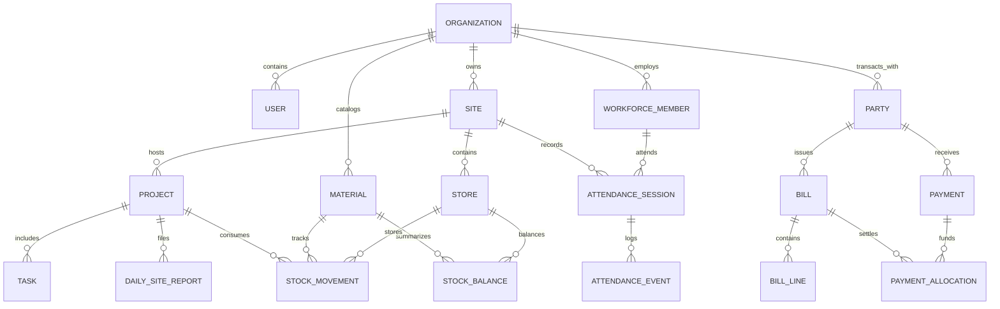

# Database Schema & Relational Model

## 1. Relational Entity Overview

The schema is built with strict foreign keys, multi-tenant isolation via `organization_id`, domain indexes, and non-nullable audit fields. It is implemented in Prisma ORM (`prisma/schema.prisma`), running SQLite for local zero-dependency development and mapping directly to PostgreSQL for production.

## 2. Detailed Table Specifications

### Identity, Tenancy & Permissions
1. **organizations**
   - `id`: String (UUID, PK)
   - `name`: String
   - `currency`: String (default: "INR")
   - `timezone`: String (default: "Asia/Kolkata")
   - `settings_json`: String / JSON
   - `status`: String ("ACTIVE", "SUSPENDED")
   - `created_at`: DateTime (UTC)
   - `updated_at`: DateTime (UTC)

2. **users**
   - `id`: String (UUID, PK)
   - `organization_id`: String (FK -> organizations.id)
   - `name`: String
   - `email`: String (Unique per organization or system-wide)
   - `password_hash`: String
   - `role`: String ("SUPER_ADMIN", "ORG_ADMIN", "PROJECT_MANAGER", "SITE_SUPERVISOR", "ACCOUNTANT", "STOREKEEPER", "HR_VIEWER", "AUDITOR")
   - `status`: String ("ACTIVE", "INACTIVE")
   - `last_login_at`: DateTime nullable
   - `created_at`: DateTime (UTC)
   - `updated_at`: DateTime (UTC)

3. **sites**
   - `id`: String (UUID, PK)
   - `organization_id`: String (FK -> organizations.id)
   - `name`: String
   - `code`: String
   - `address`: String
   - `latitude`: Float nullable
   - `longitude`: Float nullable
   - `status`: String ("ACTIVE", "ARCHIVED")
   - `created_at`: DateTime (UTC)

4. **projects**
   - `id`: String (UUID, PK)
   - `organization_id`: String (FK -> organizations.id)
   - `site_id`: String (FK -> sites.id)
   - `code`: String (Unique per org)
   - `name`: String
   - `manager_user_id`: String nullable (FK -> users.id)
   - `status`: String ("PLANNING", "IN_PROGRESS", "ON_HOLD", "COMPLETED")
   - `start_date`: DateTime nullable
   - `end_date`: DateTime nullable
   - `budget_amount`: Int (minor units / paise)
   - `notes`: String nullable
   - `created_at`: DateTime (UTC)

### Work & Tasks
5. **tasks**
   - `id`: String (UUID, PK)
   - `organization_id`: String (FK -> organizations.id)
   - `project_id`: String (FK -> projects.id)
   - `title`: String
   - `description`: String nullable
   - `priority`: String ("LOW", "MEDIUM", "HIGH", "CRITICAL")
   - `status`: String ("TODO", "IN_PROGRESS", "BLOCKED", "COMPLETED")
   - `assignee_user_id`: String nullable (FK -> users.id)
   - `due_at`: DateTime nullable
   - `created_by`: String (FK -> users.id)
   - `created_at`: DateTime (UTC)
   - `updated_at`: DateTime (UTC)

6. **task_status_history**
   - `id`: String (UUID, PK)
   - `task_id`: String (FK -> tasks.id)
   - `old_status`: String
   - `new_status`: String
   - `changed_by`: String (FK -> users.id)
   - `note`: String nullable
   - `created_at`: DateTime (UTC)

7. **daily_site_reports**
   - `id`: String (UUID, PK)
   - `organization_id`: String (FK -> organizations.id)
   - `project_id`: String (FK -> projects.id)
   - `report_date`: String (YYYY-MM-DD)
   - `progress`: String
   - `blockers`: String nullable
   - `safety_notes`: String nullable
   - `created_by`: String (FK -> users.id)
   - `created_at`: DateTime (UTC)

### Materials & Authoritative Stock Ledger
8. **material_categories**
   - `id`: String (UUID, PK)
   - `organization_id`: String (FK -> organizations.id)
   - `name`: String
   - `created_at`: DateTime (UTC)

9. **materials**
   - `id`: String (UUID, PK)
   - `organization_id`: String (FK -> organizations.id)
   - `category_id`: String nullable (FK -> material_categories.id)
   - `sku`: String (Unique per org)
   - `name`: String
   - `unit_code`: String ("BAG", "KG", "TONNE", "LITRE", "METER", "PIECE", "BOX")
   - `min_stock_qty`: Float (default 0)
   - `reorder_qty`: Float (default 0)
   - `active`: Boolean (default true)
   - `created_at`: DateTime (UTC)

10. **stores**
    - `id`: String (UUID, PK)
    - `organization_id`: String (FK -> organizations.id)
    - `site_id`: String (FK -> sites.id)
    - `name`: String (e.g. "Main Yard Store", "Site Store 1")
    - `status`: String ("ACTIVE", "ARCHIVED")
    - `created_at`: DateTime (UTC)

11. **stock_movements** (Authoritative Ledger)
    - `id`: String (UUID, PK)
    - `organization_id`: String (FK -> organizations.id)
    - `material_id`: String (FK -> materials.id)
    - `store_id`: String (FK -> stores.id)
    - `movement_type`: String ("RECEIPT", "ISSUE", "TRANSFER_IN", "TRANSFER_OUT", "ADJUSTMENT", "OPENING")
    - `quantity_delta`: Float (positive for incoming, negative for outgoing)
    - `unit_code`: String
    - `unit_rate`: Int nullable (minor units / paise)
    - `movement_at`: DateTime (UTC)
    - `vendor_party_id`: String nullable (FK -> parties.id)
    - `project_id`: String nullable (FK -> projects.id)
    - `task_id`: String nullable (FK -> tasks.id)
    - `reference_doc`: String nullable (Challan #, PO #, Transfer Voucher #)
    - `reversal_of_id`: String nullable
    - `notes`: String nullable
    - `created_by`: String (FK -> users.id)
    - `created_at`: DateTime (UTC)

12. **stock_balances** (Projected Fast Cache, reconciled with ledger)
    - `id`: String (UUID, PK)
    - `material_id`: String (FK -> materials.id)
    - `store_id`: String (FK -> stores.id)
    - `quantity_on_hand`: Float (default 0)
    - `updated_at`: DateTime (UTC)

### Parties & Financial Records
13. **parties**
    - `id`: String (UUID, PK)
    - `organization_id`: String (FK -> organizations.id)
    - `party_type`: String ("VENDOR", "CONTRACTOR", "BOTH")
    - `name`: String (e.g. "Asian Paints Ltd", "Supreme Steel Corp", "Ramesh Electricals")
    - `phone`: String nullable
    - `email`: String nullable
    - `address`: String nullable
    - `tax_identifier`: String nullable (GSTIN / PAN)
    - `active`: Boolean (default true)
    - `created_at`: DateTime (UTC)

14. **bills**
    - `id`: String (UUID, PK)
    - `organization_id`: String (FK -> organizations.id)
    - `party_id`: String (FK -> parties.id)
    - `project_id`: String nullable (FK -> projects.id)
    - `bill_number`: String
    - `bill_date`: DateTime
    - `due_date`: DateTime nullable
    - `total_amount`: Int (minor units / paise)
    - `status`: String ("DRAFT", "POSTED", "VOIDED")
    - `notes`: String nullable
    - `created_by`: String (FK -> users.id)
    - `posted_at`: DateTime nullable
    - `created_at`: DateTime (UTC)

15. **bill_lines**
    - `id`: String (UUID, PK)
    - `bill_id`: String (FK -> bills.id)
    - `description`: String
    - `material_id`: String nullable (FK -> materials.id)
    - `quantity`: Float nullable
    - `unit_rate`: Int nullable (paise)
    - `line_total`: Int (paise)

16. **payments**
    - `id`: String (UUID, PK)
    - `organization_id`: String (FK -> organizations.id)
    - `party_id`: String (FK -> parties.id)
    - `project_id`: String nullable (FK -> projects.id)
    - `payment_date`: DateTime
    - `amount`: Int (minor units / paise)
    - `currency`: String (default: "INR")
    - `method`: String ("BANK_TRANSFER", "UPI", "CASH", "CHEQUE", "NEFT_RTGS")
    - `reference_number`: String (UTR / Cheque #)
    - `status`: String ("DRAFT", "POSTED", "REVERSED")
    - `idempotency_key`: String (Unique per org)
    - `reversed_at`: DateTime nullable
    - `reversal_reason`: String nullable
    - `notes`: String nullable
    - `created_by`: String (FK -> users.id)
    - `created_at`: DateTime (UTC)

17. **payment_allocations**
    - `id`: String (UUID, PK)
    - `payment_id`: String (FK -> payments.id)
    - `bill_id`: String (FK -> bills.id)
    - `amount`: Int (minor units / paise)
    - `created_at`: DateTime (UTC)

### Workforce & Attendance
18. **workforce_members**
    - `id`: String (UUID, PK)
    - `organization_id`: String (FK -> organizations.id)
    - `employee_code`: String (Unique per org)
    - `name`: String
    - `worker_type`: String ("MASON", "CARPENTER", "ELECTRICIAN", "PLUMBER", "HELPER", "FOREMAN", "SITE_ENGINEER")
    - `phone`: String nullable
    - `default_site_id`: String nullable (FK -> sites.id)
    - `daily_wage_rate`: Int nullable (minor units / paise)
    - `active`: Boolean (default true)
    - `created_at`: DateTime (UTC)

19. **attendance_sessions**
    - `id`: String (UUID, PK)
    - `organization_id`: String (FK -> organizations.id)
    - `workforce_member_id`: String (FK -> workforce_members.id)
    - `site_id`: String (FK -> sites.id)
    - `project_id`: String nullable (FK -> projects.id)
    - `work_date`: String (YYYY-MM-DD)
    - `check_in_at`: DateTime
    - `check_in_lat`: Float nullable
    - `check_in_lng`: Float nullable
    - `check_in_accuracy_m`: Float nullable
    - `check_out_at`: DateTime nullable
    - `check_out_lat`: Float nullable
    - `check_out_lng`: Float nullable
    - `check_out_accuracy_m`: Float nullable
    - `status`: String ("PRESENT", "HALF_DAY", "OVERTIME", "CORRECTED", "ABSENT")
    - `notes`: String nullable
    - `corrected_by`: String nullable (FK -> users.id)
    - `correction_reason`: String nullable
    - `created_by`: String (FK -> users.id)
    - `created_at`: DateTime (UTC)

### Audit & Security
20. **audit_events**
    - `id`: String (UUID, PK)
    - `organization_id`: String (FK -> organizations.id)
    - `actor_user_id`: String (FK -> users.id)
    - `action`: String (e.g. "PAYMENT_POSTED", "PAYMENT_REVERSED", "STOCK_ADJUSTED", "ATTENDANCE_CORRECTED", "ROLE_CHANGED")
    - `entity_type`: String
    - `entity_id`: String
    - `before_json`: String nullable
    - `after_json`: String nullable
    - `reason`: String nullable
    - `created_at`: DateTime (UTC)

21. **idempotency_records**
    - `id`: String (UUID, PK)
    - `organization_id`: String
    - `key`: String
    - `operation`: String
    - `response_code`: Int
    - `response_body_json`: String
    - `created_at`: DateTime (UTC)
