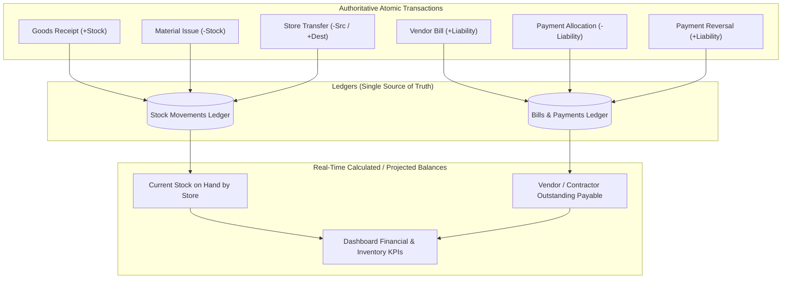

# Cross-Module Data Synchronization Rules

## 1. Single Source of Truth Principles

Derived totals and balances must never be stored as independent, separately editable fields. All balances are either dynamically aggregated from posted ledger rows or maintained as synchronous projections within transactional blocks.

## 2. Inventory Rules & Ledger Consistency
1. **Stock Movement Delta**:
   - `RECEIPT`: Positive delta `+Q`.
   - `ISSUE`: Negative delta `-Q`.
   - `TRANSFER`: Atomic pair: `-Q` in Store A, `+Q` in Store B.
   - `ADJUSTMENT`: Signed delta `(+/- Q)`.
2. **Current Stock Balance**:
   $$\text{Current Stock} = \sum \text{quantity\_delta for all non-reversed movements in that store}$$
3. **No Negative Stock Rule**:
   - Standard issues and transfers check: `currentStock >= requestedQty`. If `currentStock < requestedQty`, transaction aborts with `INSUFFICIENT_STOCK`.
4. **Unit Consistency**:
   - Material movements enforce the registered `unitCode` of the material catalog (e.g. `BAG`, `KG`, `TONNE`, `LITRE`). Unit conversions must be explicitly executed via adjustments.

## 3. Vendor & Contractor Financial Consistency
1. **Liability Creation**:
   - A posted bill of amount $B$ increases the party's outstanding payable by $+B$.
2. **Settlement**:
   - A posted payment with an allocation $A$ to a bill reduces the bill's pending balance by $-A$ and reduces the party's total outstanding balance by $-A$.
   $$\text{Bill Outstanding} = \text{total\_amount} - \sum \text{allocated\_amounts}$$
   $$\text{Party Outstanding} = \sum \text{Posted Bills} - \sum \text{Valid Payment Allocations}$$
3. **Payment Reversal**:
   - A reversed payment invalidates its allocations, setting `reversed_at = NOW()` and instantly restoring the bills' outstanding balances. The original payment record is preserved with an audit log reason.
4. **Consistency Across Screens**:
   - The Vendor Detail Page, Bill Detail Page, Payments Register, Dashboard Payables Card, and Financial Reports query the same calculation service. No screen may display a divergent total.

## 4. Workforce & Attendance Consistency
1. **One Active Shift Rule**:
   - A worker can have at most one open check-in session on a given calendar date for a site.
2. **Chronological Validity**:
   - Check-out timestamp must be greater than check-in timestamp (`checkOutAt > checkInAt`).
3. **Correction Auditing**:
   - Direct edits to attendance sessions require a supervisor/admin reason and preserve previous timestamps in the audit trail.
