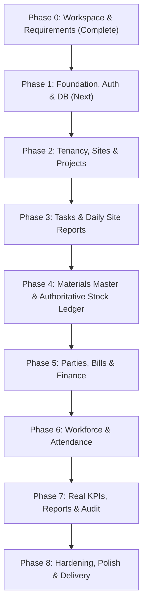

# Implementation Plan & Phase Tracker

## 1. Phased Execution Roadmap

## 2. Phase Breakdown & Exit Criteria

### Phase 0: Workspace & Requirements
- [x] Inspect workspace and environment tooling (Node v24, npm v11, git).
- [x] Select tech stack: Next.js 14+ App Router, TypeScript, Prisma ORM (SQLite local / Postgres production), Tailwind CSS, Vitest.
- [x] Author all documentation specifications in `/docs`.
- [x] Create `.env.example` and root `README.md`.
- **Exit Criteria**: All 14 `/docs` files written; stack decision recorded. (Status: **DONE**)

### Phase 1: Foundation (App Scaffold, Auth, Session & RBAC)
- [ ] Scaffold Next.js TypeScript application with Tailwind CSS and Lucide icons.
- [ ] Configure Prisma schema with initial migrations for Organizations, Users, Sites, Audit.
- [ ] Implement secure password hashing (`bcryptjs`) and session handling.
- [ ] Build RBAC and scoping middleware/services.
- [ ] Implement responsive UI shell (desktop sidebar + mobile supervisor header & dock).
- [ ] Configure Vitest test runner.
- **Exit Criteria**: Clean npm install, Prisma migrations applied, auth tests pass, responsive layout renders. (Status: **IN_PROGRESS**)

### Phase 2: Tenancy, Sites & Projects
- [ ] Implement Organization & Site management.
- [ ] Implement Project CRUD with manager assignment, budget (paise), start/end dates.
- [ ] Multi-tenant scoping and cross-site access boundary verification.
- **Exit Criteria**: Projects and sites operational; access isolation tests pass.

### Phase 3: Tasks & Daily Site Reports
- [ ] Implement Task creation, assignment, due date, and priority.
- [ ] Implement Task status lifecycle (`TODO`, `IN_PROGRESS`, `BLOCKED`, `COMPLETED`) with audit history.
- [ ] Implement Daily Site Report (DSR) logging for progress, blockers, and safety notes.
- [ ] Mobile supervisor quick-action workflow for task updates.
- **Exit Criteria**: Task lifecycle and DSR tests pass.

### Phase 4: Materials Master & Authoritative Stock Ledger
- [ ] Implement Materials Catalog (SKU, name, category, unit, min stock).
- [ ] Implement Site Stores and Stock Movements ledger (`RECEIPT`, `ISSUE`, `TRANSFER`, `ADJUSTMENT`).
- [ ] Implement atomic Goods Receipt workflow with vendor, challan number, and unit rate.
- [ ] Implement Task Material Issue workflow with negative stock prevention.
- [ ] Implement atomic Inter-Store Transfer.
- [ ] Build Material Detail view showing live stock, valuation, and chronological ledger with running balance.
- **Exit Criteria**: All inventory acceptance tests pass; ledger balance reconciles.

### Phase 5: Parties, Bills & Financial Records
- [ ] Implement Vendors & Contractors registry with tax ID and contact details.
- [ ] Implement Bills with line items and due dates.
- [ ] Implement Payments with methods (Bank Transfer, UPI, Cheque, Cash) and Idempotency Key.
- [ ] Implement Payment Allocation service updating bill outstanding balances.
- [ ] Implement Payment Reversal with audit reasoning.
- [ ] Vendor/Contractor Statement page showing chronological ledger and exact outstanding balance.
- **Exit Criteria**: Financial acceptance tests pass (₹10,000 bill - ₹4,000 payment = ₹6,000 outstanding across all screens).

### Phase 6: Workforce & Attendance
- [ ] Implement Workforce Member registry (workers, trades, wage rates).
- [ ] Implement Daily Attendance check-in and check-out with timestamp and optional GPS snapshot.
- [ ] Enforce valid attendance sequence (no checkout without checkin, no duplicate active checkin).
- [ ] Implement Attendance Correction workflow with supervisor reason.
- **Exit Criteria**: Attendance state machine and privacy/scoping tests pass.

### Phase 7: Real Dashboards, Reports & Audit
- [ ] Build Dashboard with real database-backed KPI cards (active projects, overdue tasks, workers present, low stock, payments made today, outstanding payables).
- [ ] Build Stock Movement and Financial Statement report views with date filtering and CSV export.
- [ ] Build System Audit Trail viewer for sensitive actions.
- **Exit Criteria**: Dashboard KPIs equal real database query values on verified fixtures.

### Phase 8: Hardening, Verification & Delivery
- [ ] Run complete test suite (unit + integration).
- [ ] Responsive layout verification (mobile supervisor view & desktop tables).
- [ ] Security audit: verify IDOR prevention, input sanitization, and credential handling.
- [ ] Final setup and deployment verification.
- **Exit Criteria**: 100% tests passing, clean build, zero errors.
