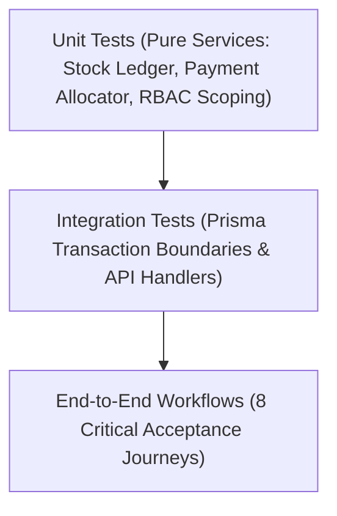

# Test Plan & Quality Assurance Strategy

## 1. Testing Pyramid & Tooling

- **Test Runner**: Vitest (`npm run test`)
- **Assertions**: Vitest built-in matchers (`expect`, `describe`, `it`, `beforeEach`)
- **Database Strategy**: Fast in-memory or isolated SQLite test database with automated migrations applied prior to test execution.

## 2. Test Suite Specifications

### Suite A: Unit Tests (Business Logic & Invariants)
1. **RBAC & Scoping Evaluation**:
   - Verify `hasPermission(role, permission)` for all roles in matrix.
   - Verify cross-site access denial when a supervisor attempts site mutations outside their scope.
2. **Stock Ledger Calculations**:
   - Verify calculation of running balances across sequence of movements.
   - Verify negative stock prevention throws domain exception.
   - Verify unit code mismatch rejection.
3. **Financial Math & Decimal Safety**:
   - Verify integer minor units (paise) math: ₹10,000 (1,000,000 paise) minus ₹4,000 (400,000 paise) = ₹6,000 (600,000 paise).
   - Verify over-allocation prevention (cannot allocate ₹5,000 to a ₹4,000 bill).
4. **Attendance State Machine**:
   - Verify check-in creates `OPEN` session.
   - Verify check-out closes session and calculates elapsed duration.
   - Verify checkout before checkin is rejected.

### Suite B: Integration Tests (Database & Transactions)
1. **Material Receipt Transaction**:
   - Posting goods receipt creates `StockMovement` (+10) and verifies store stock balance increases by exactly 10.
2. **Material Issue Transaction**:
   - Issuing 3 units reduces stock balance by exactly 3 and links `projectId` and `taskId`.
3. **Atomic Inter-Store Transfer**:
   - Transferring 5 units atomically decrements Store A (-5) and increments Store B (+5).
   - Simulating an abort in Store B rolls back Store A decrement completely.
4. **Bill & Payment Allocation**:
   - Create bill of ₹10,000.
   - Allocate payment of ₹4,000.
   - Verify bill outstanding is ₹6,000 and party balance is ₹6,000.
5. **Payment Idempotency**:
   - Repeatedly submitting identical payment with same `Idempotency-Key` returns the committed payment without creating a duplicate record.
6. **Payment Reversal**:
   - Reversing a ₹4,000 payment restores the bill's pending payable back to ₹10,000 and generates an audit log row.

### Suite C: Security & Edge Case Tests
1. **Cross-Tenant IDOR Attack**:
   - User from Organization A attempts to fetch or mutate project/material from Organization B -> returns 403 or 404.
2. **SQL Injection & XSS Defense**:
   - Verify Prisma parameterized queries neutralize malicious payloads in search filters and note fields.
3. **Audit Trail Completeness**:
   - Verify sensitive actions (`PAYMENT_POSTED`, `PAYMENT_REVERSED`, `STOCK_ADJUSTMENT`, `ATTENDANCE_CORRECTION`) record actor and timestamp.

## 3. Exit Gates & Acceptance Verification
Before concluding any implementation phase:
- All unit and integration test suites must pass without errors (`0 failed`).
- Zero unhandled console warnings or memory leaks.
- Verification that database migrations run smoothly on a clean slate.
